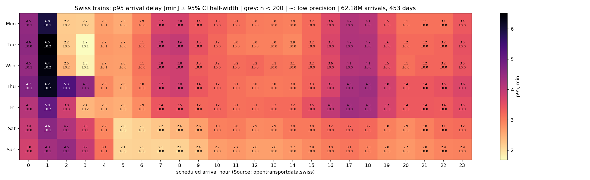
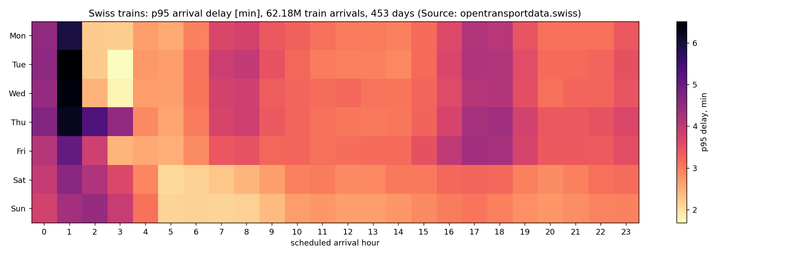
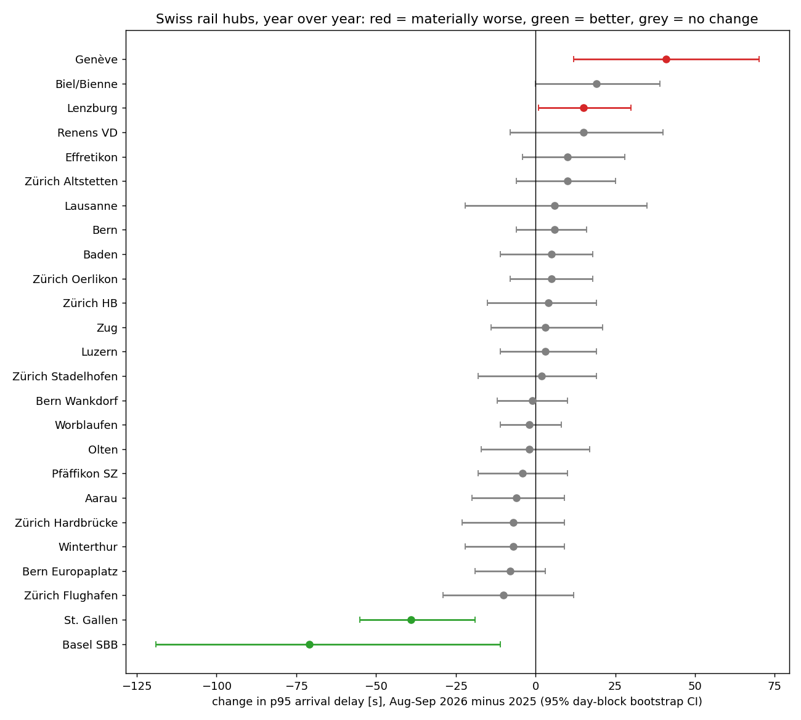
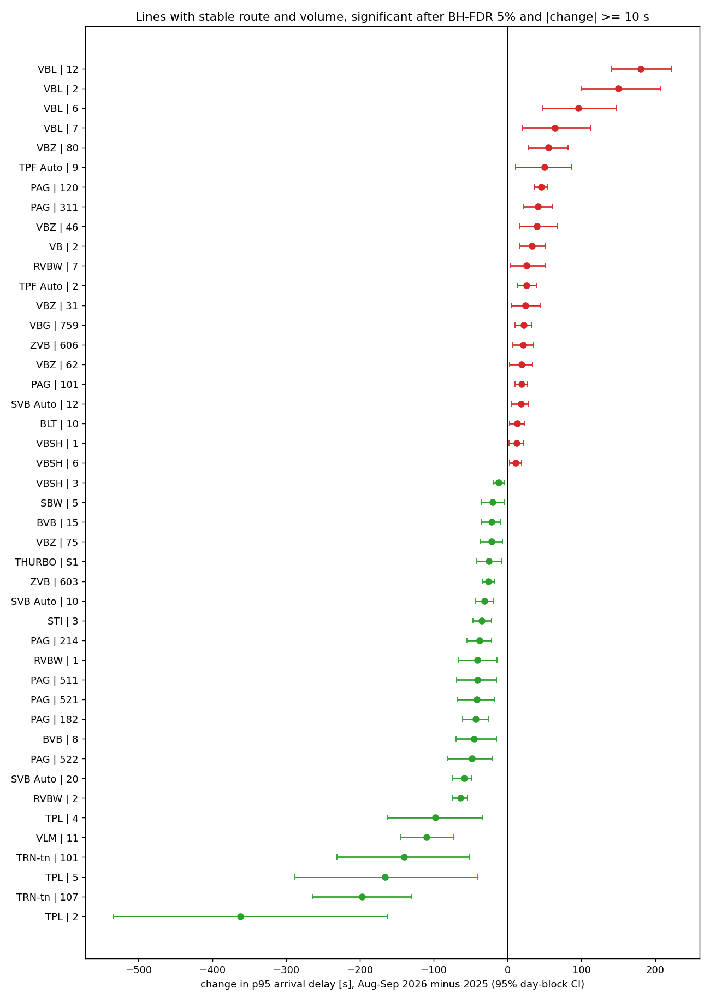
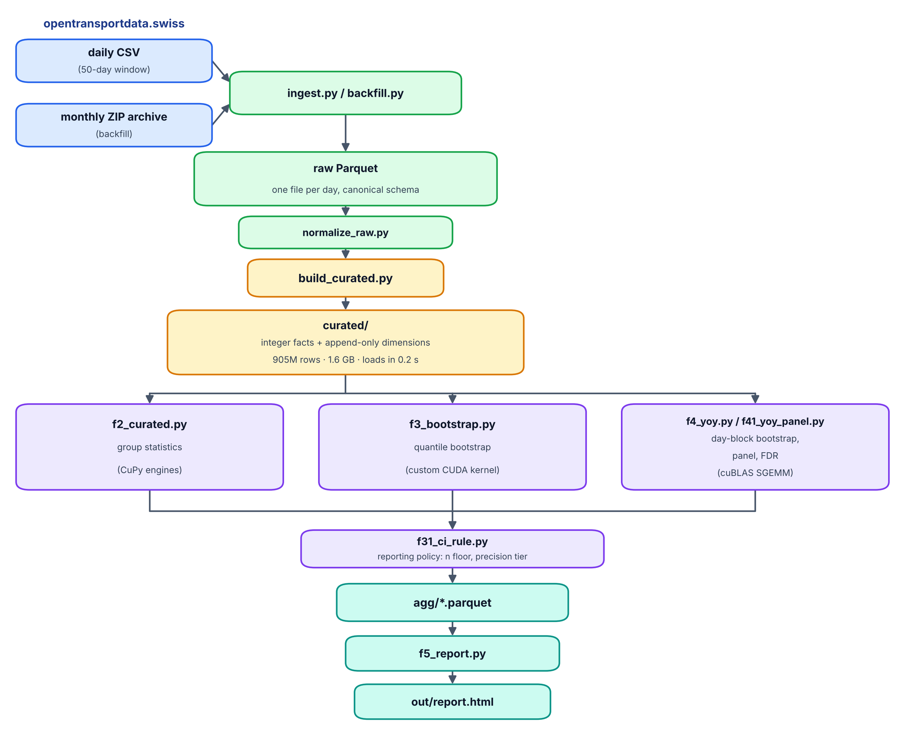
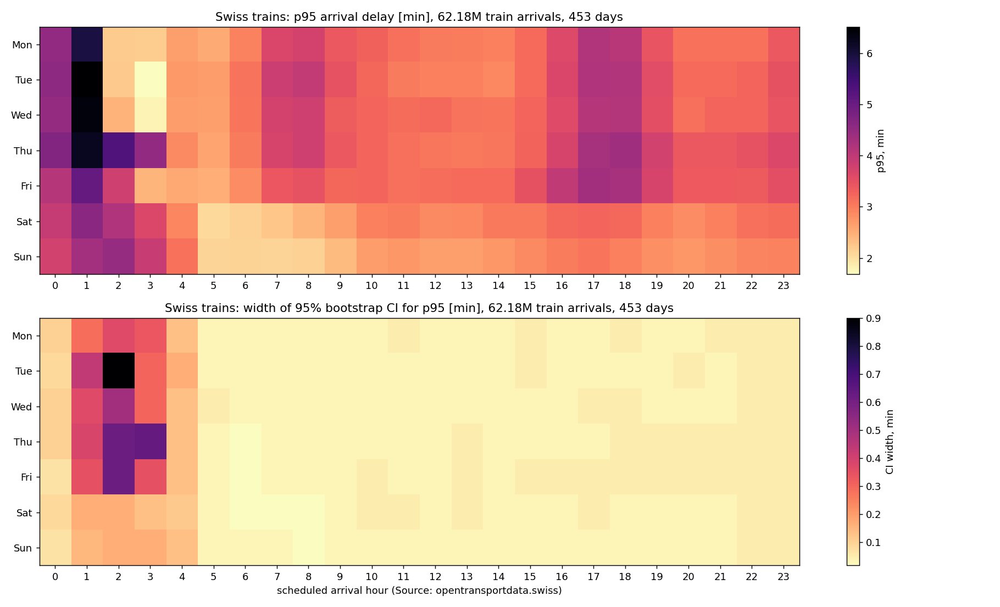
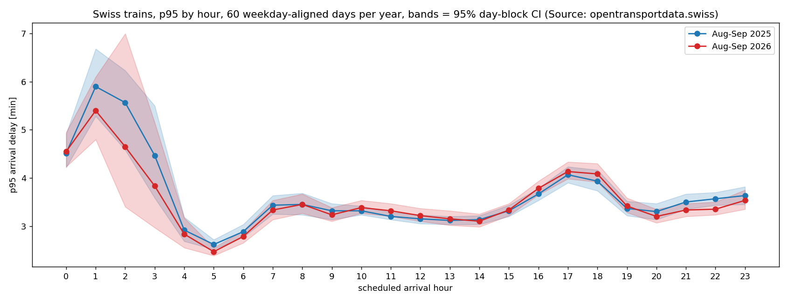
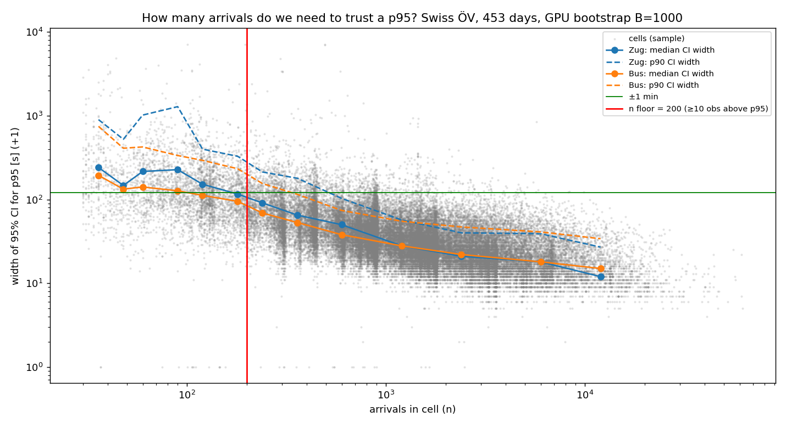

# swiss-stats: GPU Statistics on 905M Swiss Public-Transport Arrivals

**Punctuality of every train, tram, bus, boat and metro arrival in Switzerland, 453 days, computed on one Tesla P100 with auditable statistics.**

[](https://developer.nvidia.com/cuda-toolkit)
[](https://cupy.dev)
[](https://pola.rs)
[](https://www.python.org)
[](https://opentransportdata.swiss)
[](LICENSE)

Every arrival in the Swiss national real-time feed (*Ist-Daten v2*) from July 2025 to October 2026: **904,977,745 measured arrivals** at 23,911 stops on 2,488 lines. The pipeline turns 220 GB of CSV into a 1.6 GB integer layer, three GPU engines compute group statistics and bootstrap confidence intervals in seconds, and a day-block bootstrap with false-discovery control decides what changed year over year. Every GPU number is cross-checked against an independent CPU computation.



*Swiss trains, p95 arrival delay in minutes ± CI half-width, 62M train arrivals. Weekday 1:00 is the worst hour of the week; the evening peak at 17–18 h is identical Monday to Friday.*

## Highlights

| Metric | Value |
|---|---|
| Measured arrivals analysed | **904,977,745** over 453 days |
| Bootstrap CIs for p95, 445k groups × 1000 replicates | **0.74 s on GPU** vs 2.9 h naive CPU (**14,138×**) |
| GPU vs CPU cross-check | **0 mismatches** on 444,944 groups (n, p50, p95) |
| Data-quality rules found in the data | **6**, one of them removing delays of −56 years |
| Design effect of naive vs honest intervals | **2.5–10×** too narrow when arrivals are treated as independent |
| Naive year-over-year claims that survived like-for-like + FDR | **44 of 79** |

## Table of Contents

- [Key Findings](#key-findings)
- [Pipeline](#pipeline)
- [Quick Start](#quick-start)
- [GPU Engines](#gpu-engines)
- [Bootstrap Kernel](#bootstrap-kernel)
- [Statistical Method](#statistical-method)
- [Data Quality Rules](#data-quality-rules)
- [Reporting Policy](#reporting-policy)
- [Benchmarks](#benchmarks)
- [Project Structure](#project-structure)
- [Requirements](#requirements)
- [Data and Licence](#data-and-licence)
- [Roadmap](#roadmap)
- [Author](#author)

## Key Findings

Network-level punctuality is stable year over year. Change is local.

| Level | Finding |
|---|---|
| **Modes** | Trains arrive within 3 min 93.9 % of the time, trams 91.2 %, buses 86.1 %. Zahnradbahn arrive *early* 23 % of the time: on-time looks excellent, timetable accuracy does not. |
| **Rail hubs** | Zürich HB p95 = 206 s [205, 207]. Basel SBB is the outlier at 450 s [441, 458]; the heavy tail is international traffic (SBB EuroCity p95 = 32 min). |
| **Hours** | Weekday 1:00 is the worst hour (p95 6.0–6.5 min ± 0.2). The evening peak 17–18 h is 4.2–4.3 min, identical Mon–Fri. |
| **Year over year** | Aug–Sep 2026 vs 2025: 24 of 25 hubs, all 24 train hours and all modes unchanged after FDR. St. Gallen improved by 39 s [19, 55]. 21 lines materially worse (Luzern's VBL 2/6/7/12: +64 to +180 s), 23 better (Lugano's TPL 2/4/5: −98 to −362 s; Neuchâtel's TRN 101/107: +18 to +20 pp on time). |



*The raw picture before any interval: night hours and the evening peak dominate; weekends are calmer all day.*



*25 rail hubs, Aug–Sep 2026 minus 2025. After FDR only St. Gallen's improvement stands; Genève and Basel miss zero but do not survive the correction.*



*The 44 lines with stable route and volume whose change survived Benjamini–Hochberg at 5 %. Operators cluster: VBL (Luzern) worse, TPL (Lugano) and TRN (Neuchâtel) better.*

Interactive report with hover, sortable tables and all intervals: [`out/report.html`](out/report.html) (self-contained, regenerated by `src/f5_report.py`).

## Pipeline



| Stage | What happens | Numbers |
|---|---|---|
| **Ingest** | Polars parses a daily CSV into zstd Parquet with a canonical schema; every day is validated (timestamp parse failure < 0.1 %, absurd delays, share of Swiss stops) and logged to a manifest. A systemd timer with `MemoryMax` collects each new day; the archive backfill streams monthly ZIPs day by day. | 630 MB → 28 MB per day (23×), ~1 s |
| **Curated layer** | Strings encoded once into append-only dimensions; the fact table holds only integers. New days never re-code history. Rebuild runs in batches of 20 days. | 905M rows, 1.6 GB, loads in 0.2 s, 4.8 GB RAM peak |
| **Shared GPU** | Free VRAM is read at start, budget = `min(config, free − 1 GB)`, work partitioned by station so the result is exact at any budget, OOM doubles the partition count. The guard refuses any GPU but the one pinned by UUID. | 3–23 partitions, 3–4 GB VRAM |
| **Cross-check** | The largest grouping is recomputed with Polars on every run and joined on the key. | 0 mismatches, every run |

## Quick Start

```bash
# Python 3.9+, CUDA 12.x driver, a Pascal-or-newer NVIDIA GPU
git clone https://github.com/maltsev-andrey/swiss-stats.git && cd swiss-stats
pip install -r requirements.txt
cp config/config.example.yaml config/config.yaml      # set gpu_uuid, data_root

python src/ingest.py all          # last ~50 days from the daily feed
python src/backfill.py            # 2025-07 … today from the monthly archive (~1 h)
python src/normalize_raw.py
python src/build_curated.py --rebuild

python src/f2_curated.py          # group statistics, GPU + CPU cross-check
python src/f3_bootstrap.py        # bootstrap CIs, three-level benchmark
python src/f31_ci_rule.py         # reporting policy
python src/f4_yoy.py && python src/f41_yoy_panel.py   # year over year
python src/f5_report.py           # → out/report.html
```

Expected resources for 15 months: ~220 GB of transient downloads, 13 GB raw Parquet, 1.6 GB curated, ~50 GB RAM peak in the CPU cross-check, 4–6 GB VRAM. The analysis chain runs in about six minutes on 905M rows.

## GPU Engines

| Engine | Problem | Idea | Result |
|---|---|---|---|
| **Sort engine** | per-group n, mean, on-time share, p50/p90/p95 for 445k station × mode × hour groups | pack `(group_id << 14) \| (delay + 1800)` into one int64; one radix sort leaves groups contiguous with delays ordered; quantiles become O(1) index reads, sums are int64 prefix sums | 6 groupings with all metrics in 39 s on 905M rows; 2.1× faster than Polars on 12 cores per grouping, memory-bound as expected |
| **Histogram engine** | the same statistics for global groups (mode × weekday × hour, 2,488 lines) | delays are integers in a 9,001-bin window, so a `bincount` histogram is exact and mergeable across partitions | exact at any partition size with ~600 MB of VRAM |
| **Bootstrap kernel** | 95 % CI for the p95 of every group, B = 1000 | one Beta draw and one lookup per replicate (next section) | 470M replicates in 0.74 s |

Everything is FP32 with integer accumulators, so the same kernels run unchanged on an Ampere card whose FP64 is 1/64 of FP32. Switching GPUs is a UUID in `config.yaml`.

Once the kernels ran in under a second, 90 % of wall time was host-side data movement. One stable radix argsort by partition id made every partition a contiguous slice and cut the bootstrap stage from 43 s to 8 s.

## Bootstrap Kernel

The p95 of a bootstrap replicate is its k-th order statistic, and the k-th order statistic of n uniform indices into the sorted group is

```
p95* = sorted[ floor(n · U) ],     U ~ Beta(k + 1, n − k),  k = floor(0.95 · (n − 1))
```

One Beta draw and one gather per replicate instead of a resample and a partition: the exact bootstrap distribution at O(1) per replicate. The CUDA kernel (`src/f3_bootstrap.py`) runs one thread per replicate with a counter-based splitmix64 RNG and Marsaglia–Tsang gamma sampling, in FP32.



*What the interval buys: every daytime cell is known to a few seconds; the 1:00–3:00 cells are uncertain by half a minute or more.*

Validation: on 300 random groups an honest naive bootstrap runs alongside; 97.7 % of bounds agree within tolerance, median difference 0 s.

## Statistical Method

1. **Quantiles, not means.** 8,000 garbage values removed by a data-quality rule shifted the mean and not a single p95. Punctuality is reported as p95 and on-time shares throughout.
2. **Design effect.** Arrivals within one day are correlated (weather, incidents, knock-on delays). A per-arrival bootstrap gave intervals 2.5–10× narrower than a day-block bootstrap on the same slots. Whole days are resampled; all 1,000 replicates become one `W @ H` matrix product on the GPU (cuBLAS SGEMM, 9.3× faster than multithreaded CPU BLAS).
3. **Like-for-like plus FDR.** Raw bus arrivals grew 17 % between the two summers; on a panel of lines with stable route (stop-set Jaccard ≥ 0.8) and volume (±25 %) they grew 1.3 %. After the panel and Benjamini–Hochberg at 5 %, 35 of 79 naive claims of change disappeared, 16 of them because the route had been rebuilt under the same line number.
4. **Entity resolution for lines.** Line names, operator codes and stop ids all changed within 15 months; renamed lines are re-linked by their route fingerprint.



*The hourly profile is unchanged between the two summers once whole days are resampled; the night hours are where both years are uncertain.*

| Family | Median iid CI | Median day-block CI | Design effect |
|---|---|---|---|
| hub | 8 s | 21 s | 2.5× |
| hour | 3 s | 17.5 s | 7.6× |
| mode | 4.5 s | 26 s | 7.8× |
| line | 3 s | 28.5 s | 10.1× |

## Data Quality Rules

Each rule was found by a number that looked wrong, not assumed in advance.

| # | Rule | How it surfaced |
|---|---|---|
| 1 | A Swiss stop has UIC prefix **85 as a string**, not by integer division | BPUIC comes as 7 digits (station) or 9 (platform); integer division gave 19 % "Swiss" stops instead of 98 % |
| 2 | \|delay\| > 1 day is a **broken timestamp**, not a delay | 8,821 arrival records, the worst at −56 years, almost all on weekends with bus replacement |
| 3 | One **canonical raw schema** across format evolution | the feed gained a `SLOID` column on 2025-10-13; 92 earlier day files had to be normalised |
| 4 | **Product labels** are normalised | `Bua` appeared as an eighth mode on 5,250 rows |
| 5 | Prefix 85 means *in the Swiss register*, not *in Switzerland* | Italian stations on the Luino line carry 85xxxxx codes |
| 6 | **Line identity by route fingerprint**, not by vendor name | 12 renames found by stop-set Jaccard ≥ 0.8; the remaining 99 % of volume drift was new real-time coverage |

## Reporting Policy

A p95 is shown only with n ≥ 200 (at least 10 observations above it); it is called *precise* only when the measured CI half-width is ≤ max(60 s, 20 % of p95) and the interval does not touch the clip ceiling. The threshold is derived from the data, not chosen.



*Below n = 200 the interval is dominated by the handful of observations above p95; above it the width follows 1/√n until integer-second discreteness takes over near 20 s. With 50 days the policy kept 74 % of arrivals; with 453 days, 99.4 %, and CIs narrowed by exactly √9.6 ≈ 3.1×.*

## Benchmarks

Tesla P100 (2016, 16 GB) sharing its memory with a production LLM service, against 12 CPU cores. Dataset: 905M rows.

| Task | Method | Time |
|---|---|---|
| Bootstrap CI for p95, 445k groups × 1000 replicates | CPU naive resample + partition (extrapolated) | 2.9 h |
| | CPU NumPy, Beta trick (extrapolated) | 44.3 s |
| | **GPU kernel, Beta trick** | **0.74 s** |
| | algorithm × GPU | 238× × 59× = **14,138×** |
| Day-block bootstrap, 206 slots, 2 × 1000 replicates | CPU, multithreaded BLAS (extrapolated) | 38.4 s |
| | **GPU cuBLAS SGEMM** | **4.1 s** (9.3×) |
| Group statistics, 6 groupings, all metrics | GPU CuPy engines | 39.2 s (6.5 s per grouping) |
| | CPU Polars, 12 cores, 1 grouping | 13.8 s (2.1× slower per grouping) |

The CPU baselines for the bootstrap are single-threaded; against a perfectly parallel 12-core version the GPU gain would be about 5× on top of the 238× from the algorithm. Both numbers are stated on purpose: memory-bound aggregation gains little from a GPU, compute-bound resampling gains a lot.

## Project Structure

```
swiss-stats/
├── src/
│   ├── ingest.py            daily CSV → raw Parquet, validation, manifest
│   ├── backfill.py          monthly archive ZIPs → raw Parquet, overlap check vs daily
│   ├── normalize_raw.py     one canonical schema over all day files
│   ├── build_curated.py     raw → curated integer layer, append-only dimensions
│   ├── fix_station.py       one-off backfill of data-quality rule 1
│   ├── line_identity.py     rule 6: renames by route fingerprint
│   ├── f2_aggregates.py     GPU engines: sort, histogram, adaptive VRAM budget, partitions
│   ├── f2_curated.py        group statistics on the curated layer, CPU cross-check
│   ├── f3_bootstrap.py      CUDA bootstrap kernel, three-level benchmark, validation
│   ├── f31_ci_rule.py       reporting policy, CI-vs-n plots
│   ├── f4_yoy.py            day-block bootstrap (SGEMM), design effect
│   ├── f41_yoy_panel.py     like-for-like panel, z-tests, BH-FDR, claim survival
│   └── f5_report.py         self-contained HTML report
├── config/config.example.yaml
├── systemd/                 daily collector service + timer
├── docs/                    figures and the pipeline schema (schema_png.py)
├── out/report.html          interactive report
├── requirements.txt
└── LICENSE
```

## Requirements

- Python 3.9+, CUDA 12.x driver (CUDA 13 dropped Pascal; stay on 12.x for a P100)
- NVIDIA GPU with compute capability ≥ 6.0 and ≥ 4 GB free VRAM; the budget adapts to what is free
- `cupy-cuda12x`, `polars`, `pyarrow`, `duckdb`, `numpy < 2`, `matplotlib`, `pyyaml`, `requests` (see `requirements.txt`)
- 80 GB of disk for 15 months of data; ~50 GB RAM for the full CPU cross-check (a 10 % sample is used above 200M rows)

## Data and Licence

Data: *Ist-Daten v2*, [Open Data Platform Mobility Switzerland](https://opentransportdata.swiss), open use with attribution. An arrival enters the statistics only if its stop is in the Swiss register, its status is `REAL` (measured, not forecast), the trip was not cancelled and the vehicle actually stopped.

Code: MIT, see [LICENSE](LICENSE).

## Roadmap

- Curated layer clustered by station (removes the last host-side sort)
- Country assignment from stop coordinates (rule 5) and a second route fingerprint by stop names for re-coded lines
- Seasonality across all 15 months with the same day-block engine
- Weather as a covariate: MeteoSwiss SwissMetNet, 10-minute resolution
- RTX 3090: same kernels, published P100-vs-Ampere table

## Author

**Andrey Maltsev**, infrastructure and GPU platform engineer, Switzerland
GitHub: [@maltsev-andrey](https://github.com/maltsev-andrey)
